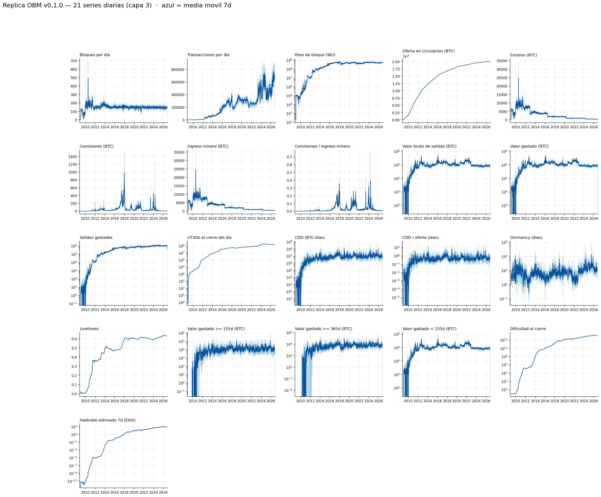
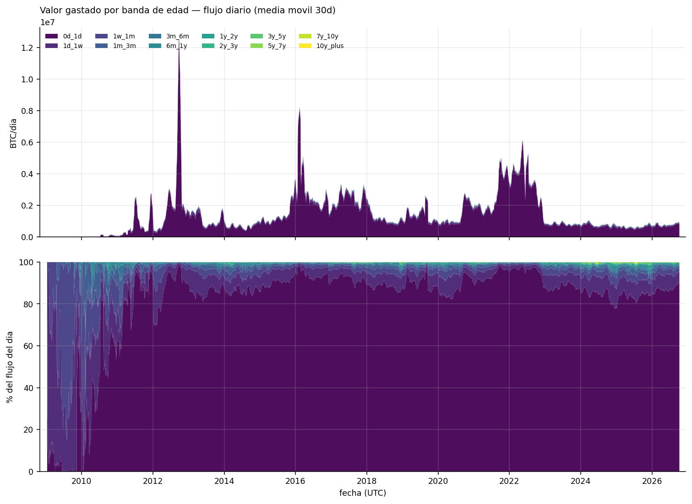
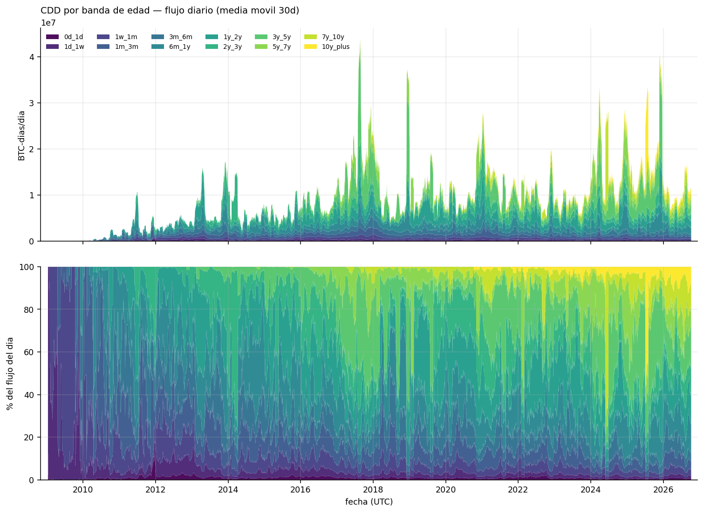
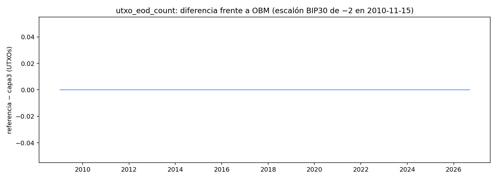
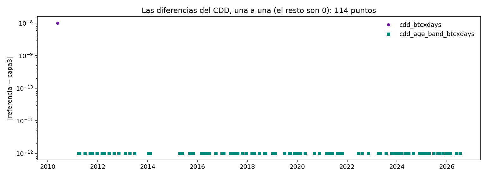
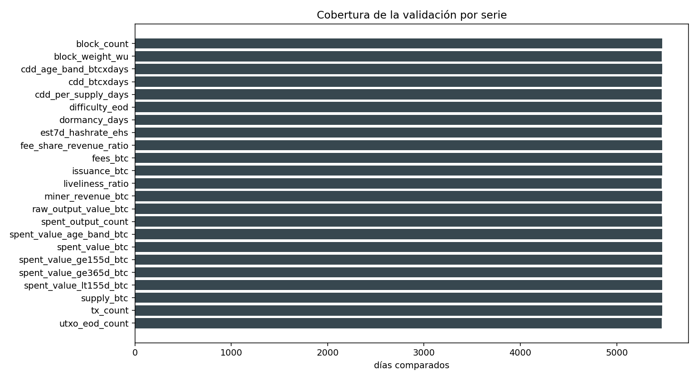

# Réplica verificable de Open Bitcoin Metrics (OBM) v0.1.0

**Un dataset diario de series temporales de Bitcoin, derivado íntegramente de un nodo completo
propio, y una auditoría de reproducibilidad de las 23 series publicadas por OBM.**

---

## Resumen

Bitcoin acumula métricas on-chain dispersas, heterogéneas y a menudo no reproducibles desde los
datos primarios de la cadena. **Open Bitcoin Metrics (OBM)** publica 23 series diarias derivadas
de un nodo completo. Este proyecto es una **reimplementación independiente** de esas series
(nodo propio, código propio, cero líneas de los autores) con un objetivo doble: **verificar** que
son reproducibles desde la cadena y **documentar con números** dónde y por qué difieren.

Resultado: **22 de 23 series bit-exactas** frente al snapshot oficial (`obm_reference/metrics/`,
v0.1.0). La única diferencia es **1 sat-día en un día de 2010**, consecuencia del redondeo en coma
flotante que OBM aplica al *Coin Days Destroyed* — no de este pipeline. En el proceso se
encontraron y corrigieron **8 hallazgos** (4 convenciones de OBM a replicar, 4 bugs propios), todos
medidos y con repro: ver [`AUDITORIA.md`](AUDITORIA.md).

**El resultado no es un fork de OBM: es una auditoría de su reproducibilidad.**

---

## 1 · Introducción y objetivo

Las series de OBM (§3 y §4 de su manuscrito, `obm_reference/paper/`) se reconstruyen desde un nodo
Bitcoin Core, un *spent-output indexer* persistente y transformaciones deterministas. La pregunta
que motiva este proyecto es de ingeniería y de método:

> ¿Se pueden re-derivar esas 23 series desde la cadena **sin usar nada del código de los autores**,
> y coincidir día a día con su publicación?

La respuesta es útil en las dos direcciones. Si coinciden, el dataset de OBM queda **verificado por
reproducción independiente**. Si difieren, la discrepancia es información: o es una **convención**
que hay que replicar (y entonces se documenta), o es un **error** de alguna de las dos partes (y
entonces se mide).

Todo número de este repositorio sale de un **script re-ejecutable**. No hay cifras escritas a mano.

## 2 · Relación con OBM y con otras fuentes

- **OBM v0.1.0** es la referencia de comparación: sus 23 CSV, su manuscrito y sus utilidades viven
  en `obm_reference/` (congelados, para que el cruce sea reproducible).
- Las métricas habituales de plataformas comerciales se mencionan en el paper de OBM; aquí no se
  usan: el objetivo es la reproducibilidad desde el nodo, no la comparación comercial.
- **No se audita el código de OBM** (no se utilizó): es una auditoría de caja negra sobre los datos
  y de caja blanca sobre la metodología publicada.

## 3 · Métodos

### 3.1 Visión del pipeline

```
        Bitcoin Core (nodo completo · txindex=1 · sin poda)   v26.0.0
                        │ JSON-RPC (getblock, getblockheader, …)
        ┌───────────────▼───────────────────────────────────────┐
capa1/  │ etl/capa1_btccore_parquet.py                          │  blocks · txs
 386 GB │ parquet semanal (zstd), clave primaria por tabla      │  inputs · outputs
        └───────────────┬───────────────────────────────────────┘
        ┌───────────────▼───────────────────────────────────────┐
capa2/  │ src/indexer.py  (spent-output indexer, §3.4 del paper)│  live_outputs.sqlite
 ~20 GB │ resuelve cada input contra su output previo           │  daily_agg · age_band_agg (DB)
        │ commit por semana: UTXO + agregados + weeks_done      │  + parquet anual derivado
        └───────────────┬───────────────────────────────────────┘
        ┌───────────────▼───────────────────────────────────────┐
capa3/  │ src/exporters/capa3_series.py                         │  obm_<serie>_daily.csv ×23
  13 MB │ 21 series largas + 2 tablas anchas, esquema OBM exacto│  VALIDACION.md + figuras/
        │ src/exporters/validar_capa3.py                        │
        └───────────────┬───────────────────────────────────────┘
        ┌───────────────▼───────────────────────────────────────┐
capa4/  │ mercado (pendiente)                                   │  klines diarios (precio)
        │ habilita valoración: NVT, MVRV, hashprice             │  → familia de valoración
        └───────────────────────────────────────────────────────┘
```

### 3.2 Configuración del nodo

Bitcoin Core **v26.0.0**, mainnet, `txindex=1`, **sin poda**. La dificultad de minería **se lee del
nodo** (`getblock`/`getblockheader`), no se recalcula: reconstruirla desde `bits` difiere en 1 ULP
de float64 en 2.825 de 6.461 días (hallazgo **F3**). Como es constante por época de 2016 bloques,
basta con **481 llamadas RPC** para todo el histórico → `capa1/difficulty_epochs.parquet`.

### 3.3 Convención temporal y agregación

- El **día** es el día **UTC del `time` del bloque** (no `mediantime`).
- El **orden de procesado es la altura**, no el tiempo: los timestamps de bloque **no son
  monótonos** (16.060 inversiones crudas; **2 de ellas cruzan una frontera de semana**). Particionar
  por semana del timestamp rompía la resolución de prevouts (hallazgo **F4**); el ETL asigna cada
  bloque a `max(semana_propia, semana_anterior)` y el índice escanea por altura.
- Los agregados se guardan **en la moneda mínima** (satoshi) y en **días de Bitcoin** con dos
  acumuladores (parte entera + resto) para que el CDD sea exacto (hallazgo **F2**).

### 3.4 El indexer de salidas gastadas

Mantiene el conjunto UTXO vivo en SQLite (clave `(txid, vout)`, `WITHOUT ROWID`) y, **en la misma
transacción por semana**, escribe: (a) los cambios del UTXO, (b) los **agregados diarios** y **por
banda de edad** (`daily_agg`, `age_band_agg`) y (c) la fila de progreso `weeks_done`. Los parquet
anuales de agregados son un **derivado** que se reconstruye entero desde la DB al arrancar y al
cerrar cada semana. Esta inversión (la DB manda, el parquet se deriva) es el arreglo definitivo del
hallazgo **F7**: un corte entre el *commit* y la escritura del parquet ya no puede perder días,
porque el siguiente arranque se repara solo.

### 3.5 Exportadores y scripts derivados

`capa3_series.py` produce las 23 series desde `capa1` + `capa2`; `validar_capa3.py` compara día a
día contra la referencia con la tolerancia de los decimales publicados y genera
`capa3/VALIDACION.md` y las figuras. Los scripts de reparación y migración puntuales
(`migrar_agregados_a_db.py`, `reparar_semana_2022W06.py`, `reparar_wrap_2017.py`, …) están
documentados en la auditoría.

### 3.6 Convención de nombres

`obm_<métrica>_<unidad>_<frecuencia>`, exactamente el esquema de OBM (p. ej.
`obm_cdd_btcxdays_daily`). Los identificadores del código van en inglés; la documentación, en
español.

## 4 · Catálogo de series

23 series diarias. **Fuente**: `B` = `capa1` (bloques), `U` = `capa2` (UTXO y coin-age),
`D` = derivada de las anteriores.

| # | Serie | Unidad | Qué es | Fuente |
|---|---|---|---|---|
| 1 | `obm_block_count_daily` | bloques | Nº de bloques del día | B |
| 2 | `obm_block_weight_wu_daily` | WU | Peso total de bloque | B |
| 3 | `obm_tx_count_daily` | txs | Nº de transacciones | B |
| 4 | `obm_difficulty_eod_daily` | — | Dificultad al cierre del día (del nodo) | B + épocas |
| 5 | `obm_est7d_hashrate_ehs_daily` | EH/s | Hashrate estimado (ventana de 7 días) | B + épocas |
| 6 | `obm_issuance_btc_daily` | BTC | Emisión = salida coinbase − comisiones | U |
| 7 | `obm_fees_btc_daily` | BTC | Comisiones = Σentradas − Σsalidas | U |
| 8 | `obm_miner_revenue_btc_daily` | BTC | Ingresos del minero (salida coinbase) | U |
| 9 | `obm_fee_share_revenue_ratio_daily` | ratio | Comisiones / ingresos del minero | U |
| 10 | `obm_supply_btc_daily` | BTC | Emisión realizada acumulada | D |
| 11 | `obm_raw_output_value_btc_daily` | BTC | Valor bruto de las salidas gastadas | U |
| 12 | `obm_spent_output_count_daily` | salidas | Nº de salidas gastadas | U |
| 13 | `obm_spent_value_btc_daily` | BTC | Valor gastado | U |
| 14 | `obm_spent_value_ge155d_btc_daily` | BTC | Valor gastado con edad ≥ 155 días | U |
| 15 | `obm_spent_value_ge365d_btc_daily` | BTC | Valor gastado con edad ≥ 365 días | U |
| 16 | `obm_spent_value_lt155d_btc_daily` | BTC | Valor gastado con edad < 155 días | U |
| 17 | `obm_utxo_eod_count_daily` | salidas | Nº de UTXO al cierre del día | U |
| 18 | `obm_cdd_btcxdays_daily` | BTC-días | Coin Days Destroyed (exacto) | U |
| 19 | `obm_cdd_per_supply_days_daily` | días | CDD por unidad de oferta | D |
| 20 | `obm_dormancy_days_daily` | días | CDD / valor gastado | D |
| 21 | `obm_liveliness_ratio_daily` | ratio | CDD acumulado / oferta acumulada | D |
| 22 | `obm_spent_value_age_band_btc_daily` | BTC × 12 | Valor gastado por banda de edad (tabla ancha) | U |
| 23 | `obm_cdd_age_band_btcxdays_daily` | BTC-días × 12 | CDD por banda de edad (tabla ancha) | U |

Las 12 bandas y los umbrales 155d/365d son **las definiciones de OBM** (incluidas sus fronteras).

### Figuras de las series

Generadas por `src/exporters/graficos_capa3.py` **desde los CSV de capa3** (no recalculan nada, así
que las figuras coinciden siempre con lo publicado), con la cobertura completa
(`2009-01-03`..`2026-10-08`).



**Figura 1** — Las 21 series diarias en un panel 5×5. En cada recuadro, la línea clara es el valor
diario y la oscura su **media móvil de 7 días**; hay escala logarítmica donde el rango abarca
órdenes de magnitud. En `supply` (oferta en circulación) se ven los cambios de pendiente de los
halvings (2012, 2016, 2020, 2024). Las 2 tablas anchas de bandas de edad van aparte.



**Figura 2** — Valor gastado por banda de edad (las 12 bandas, de `0d_1d` a `10y_plus`): arriba, el
flujo diario apilado (media móvil de 30 días); abajo, la misma composición en **porcentaje del
día**. La rampa de color es **secuencial a propósito**, porque las bandas están ordenadas por edad.



**Figura 3** — Lo mismo para el **CDD** por banda de edad (`BTC-días`), el flujo que pondera cada
moneda gastada por el tiempo que estuvo quieta.

## 5 · Validación frente a OBM

`python3 src/exporters/validar_capa3.py` — comparación día a día contra `obm_reference/metrics`,
con tolerancia = **medio último decimal publicado** de cada serie:

| Bloque de series | Resultado |
|---|---|
| 5 series de bloque | **bit-exactas** en las 6.461 fechas de la referencia |
| 12 series de flujo/UTXO | **bit-exactas** |
| 2 tablas anchas de bandas (12 columnas cada una) | **bit-exactas** |
| `cdd_btcxdays` y sus ratios derivadas | **exactas salvo 1 día** (2010-05-22, 1E-8 BTC-días = 1 sat-día) |

**22/23 bit-exactas.** Dos convenciones hay que replicarlas explícitamente:

- **BIP30**: OBM cuenta las **dos copias** de los dos coinbases duplicados de 2010 (+1 el
  2010-11-14, +2 desde el 2010-11-15). Este proyecto mantiene la unicidad `(txid,vout)` como Core y
  aplica el ajuste en `capa3` (flag `--no-bip30` para el valor "real").
- **Precisión del CDD**: con dos acumuladores enteros, el error baja de 1,77e-9 (truncar por input)
  a 8,9e-11 relativo — **223.480× menos**; el residuo restante es el de OBM.

### Figuras de la validación

Generadas por `validar_capa3.py` en `capa3/figuras/`.


**Figura 4** — Días con diferencia por serie (verde = bit-exacta, rojo = difiere). Las 22 verdes
están a **0 días**; la única roja es `cdd_btcxdays`, con **1 solo día** (invisible a esta escala).



**Figura 5** — `utxo_eod_count`: diferencia (referencia − capa3) a lo largo del tiempo. El escalón
plano de **−2 desde 2010-11-15** es exactamente el ajuste BIP30 (las dos copias de los coinbases
duplicados), no un error: por eso capa3 lo compensa.



**Figura 6** — `cdd_btcxdays`: error relativo, escala logarítmica. La mediana está en ~1e-16 (el
límite del `float64`) y los picos son el **último dígito publicado por OBM**: esta serie **no puede
ser bit-exacta** porque OBM acumula el CDD en coma flotante (hallazgo F2), mientras que aquí se
calcula con dos acumuladores enteros.



**Figura 7** — Días comparados por serie: entre **6.459 y 6.463**, porque las series de la
referencia no tienen todas la misma longitud (el denominador del «22/23» se lee por serie).

## 6 · Reproducibilidad

**Requisitos**: Bitcoin Core sincronizado (mainnet, `txindex=1`, sin poda; validado con v26.0.0),
Python 3.14 con `pyarrow`, `pandas`, `numpy`, `duckdb` y `matplotlib`, y **~450 GB libres**.
Coste medido: `capa2` tarda **~50-85 min por semana** (varios días en total).

```bash
# 1) capa1 — ETL desde el nodo (opción 1 = reset, 2 = continuar)
python3 etl/capa1_btccore_parquet.py

# 2) capa2 — indexer capa1 → capa2 (opción 1 = reset, 2 = continuar)
python3 src/indexer.py

# 3) capa3 — dificultad exacta del nodo (481 RPC, ya generada) y las 23 series
python3 src/exporters/fix_difficulty_rpc.py
python3 src/exporters/capa3_series.py

# 4) validación frente a la referencia oficial
python3 src/exporters/validar_capa3.py        # -> capa3/VALIDACION.md + figuras/

# 5) figuras de presentación (opcional; sólo lee los CSV de capa3)
python3 src/exporters/graficos_capa3.py       # -> capa3/graficos/*.png
```

**Mapa del repositorio**

| Ruta | Qué hay |
|---|---|
| `etl/` | ETL de capa1 y utilidades de reparación de semanas |
| `src/indexer.py` | indexer de capa2 (UTXO + agregados) |
| `src/exporters/` | series de capa3, validación y scripts puntuales |
| `capa1/ … capa4/` | datos (fuera de git salvo `capa3/*.csv`) |
| `obm_reference/` | snapshot oficial de OBM: `metrics/`, `paper/`, `tools/` |
| `METODOLOGIA.md` | definiciones de las 23 series tomadas del paper |
| `docs/MAPA_CODIGO.md` | mapa de módulos e invariantes del pipeline |
| `AUDITORIA.md`, `AUDITORIA_HALLAZGOS.md`, `LIMITACIONES.md` | Paquete A (auditoría) |
| `QWEN.md` | traspaso técnico para agentes de código |

## 7 · Limitaciones

Resumen; el detalle honesto son 19 puntos en [`LIMITACIONES.md`](LIMITACIONES.md):

- La referencia es un **snapshot móvil** (v0.1.0) y "exacta" significa *dentro de medio último
  decimal publicado*, no precisión infinita.
- El **CDD no se puede reproducir exactamente por construcción** (OBM acumula en coma flotante);
  las ratios que derivan de él heredan esa cota.
- La **dificultad se lee del nodo**, así que el pipeline requiere RPC, no sólo ficheros de bloque.
- **`capa4` (precio) no está incluida**: quedan fuera NVT, MVRV, realized price y hashprice.
- La auditoría **mide acuerdo, no verdad**: una interpretación equivocada compartida con OBM no la
  detectaría el cruce.

## 8 · Auditoría de reproducibilidad

Los 8 hallazgos con su medición y su repro están en [`AUDITORIA.md`](AUDITORIA.md) (presentación) y
[`AUDITORIA_HALLAZGOS.md`](AUDITORIA_HALLAZGOS.md) (material bruto). En resumen:

| Convenciones de OBM a replicar | Bugs corregidos de esta implementación |
|---|---|
| **F1** BIP30 (conteo de las dos copias) | **F4** orden altura/tiempo en el ETL |
| **F2** CDD en coma flotante | **F5** desbordamiento de 32 bits del contador |
| **F3** la dificultad se lee del nodo | **F7** ventana de crash *commit → parquet* |
| **F6** fusión al partir una fecha en dos ficheros | **F8** (×5+1) trampas del script de reparación |

## 9 · Estado del dataset

| Capa | Contenido | Estado |
|---|---|---|
| `capa1` | **970.447 bloques** (0..970.446), 928 semanas × 4 tablas, 386 GB | completa; 0 solapes, 0 duplicados, cadena intacta |
| `capa2` | **927 semanas** (`2009-W01`..`2026-W40`), UTXO en SQLite (~20 GiB), agregados diarios y por banda | completa; invariante `filas = Σinsertadas − Σgastadas` con 0 fantasmas |
| `capa3` | las 23 series diarias, hasta `2026-10-08` (27 días más allá de la referencia) | **22/23 bit-exactas** |
| `capa4` | mercado (precio) | pendiente |

## Citación

Dataset de referencia:

```bibtex
@article{llanos2026obm,
  title  = {Open Bitcoin Metrics: Verifiable Full-Node-Derived Bitcoin Time Series
            for Economic Research},
  author = {Llanos, Diego R.},
  year   = {2026},
  note   = {arXiv:2607.03124v1}
}
```

Si usas este artefacto (la réplica y su auditoría), cita el repositorio y el commit que valida el
snapshot: `AUDITORIA.md` indica el estado exacto de cada capa en el momento de la validación.
