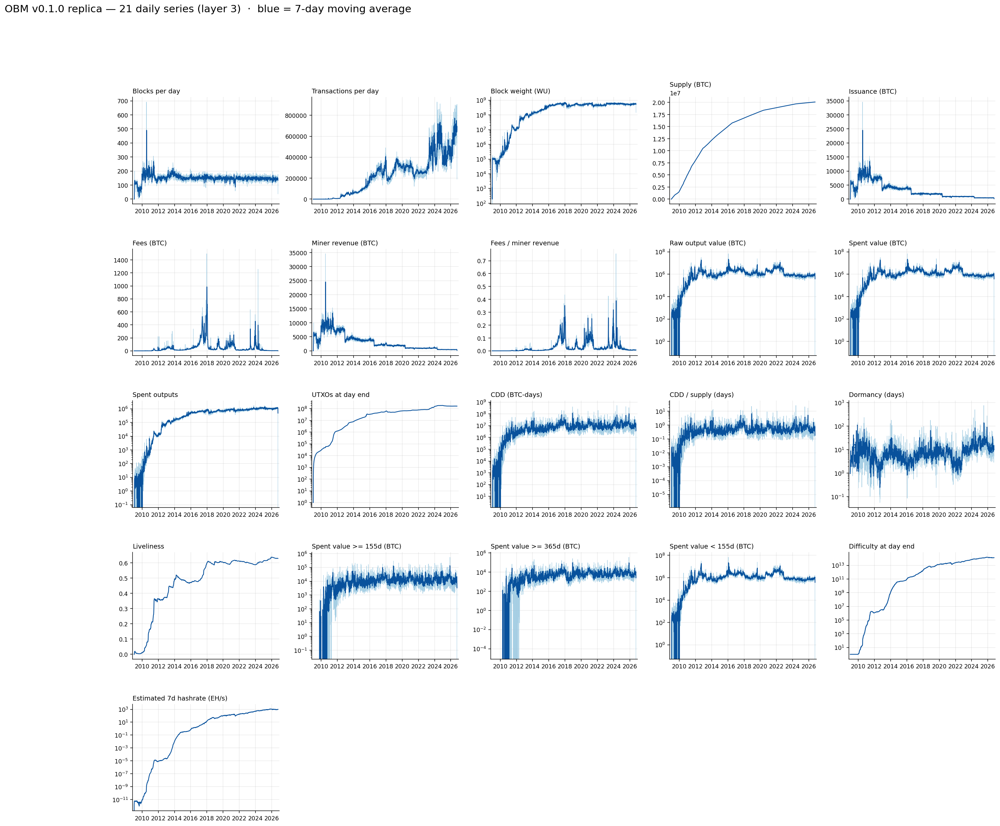
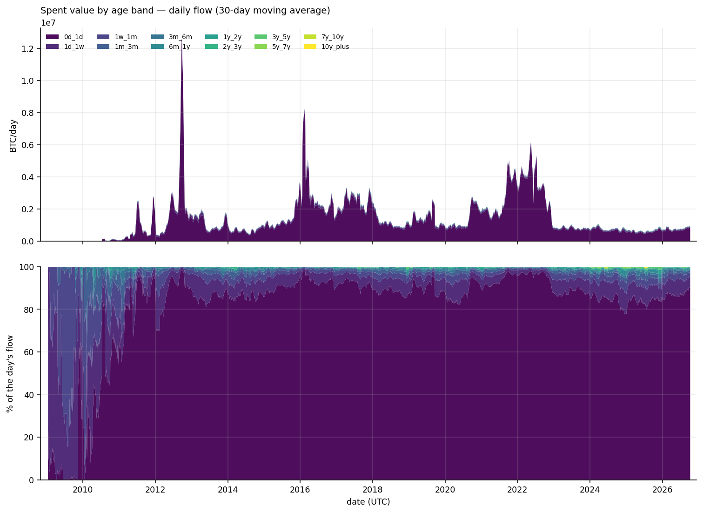
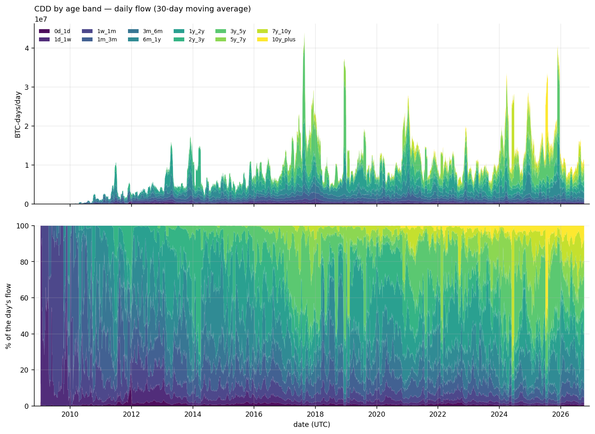
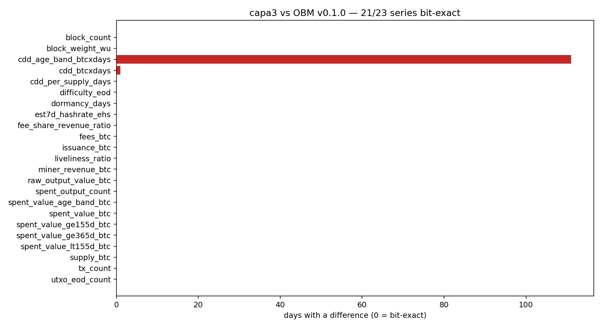
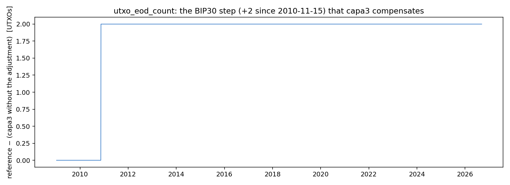
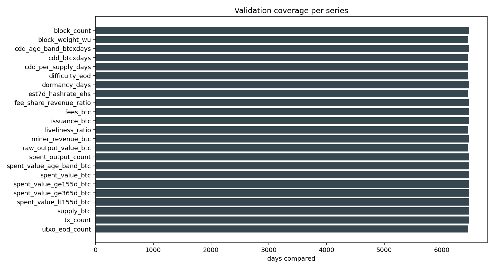

# Verifiable replication of Open Bitcoin Metrics (OBM) v0.1.0

**A daily Bitcoin time-series dataset, derived entirely from our own full node, and a
reproducibility audit of the 23 series published by OBM.**

---

## Summary

Bitcoin accumulates on-chain metrics that are scattered, heterogeneous and often not reproducible
from the primary data of the chain. **Open Bitcoin Metrics (OBM)** publishes 23 daily series derived
from a full node. This project is an **independent reimplementation** of those series (our own node,
our own code, zero lines from the authors) with a twofold aim: **to verify** that they are
reproducible from the chain and **to document with numbers** where and why they differ.

Result: **21 of 23 series bit-exact** against the official snapshot (`obm_reference/metrics/`,
v0.1.0). The two that differ are those of *Coin Days Destroyed*, and in both the discrepancy is **one
unit of the last published decimal place**: `cdd_btcxdays` at **1 day** (1 sat-day) and the wide
table `cdd_age_band` at **111 days** (1E-12; these are exact ties at decimal place 13, where our
value is the *half-even* rounding of the exact value and OBM's differs by one unit of the last decimal, in either direction). In the process
**8 findings** were found and fixed (4 OBM conventions to replicate, 4 bugs of our own), all
measured and with a repro: see [`AUDITORIA.md`](AUDITORIA.md).

**The result is not a fork of OBM: it is an audit of its reproducibility.**

---

## 1 · Introduction and objective

The OBM series (§3 and §4 of its manuscript, `obm_reference/paper/`) are rebuilt from a Bitcoin Core
node, a persistent *spent-output indexer* and deterministic transformations. The question that
motivates this project is one of engineering and of method:

> Can those 23 series be re-derived from the chain **without using anything from the authors' code**,
> and match their publication day by day?

The answer is useful in both directions. If they match, the OBM dataset is **verified by independent
reproduction**. If they differ, the discrepancy is information: either it is a **convention** that
has to be replicated (and then it is documented), or it is an **error** on one of the two sides (and
then it is measured).

Every number **the pipeline produces** comes out of a **re-executable script**. There are no hand-written
figures.

## 2 · Relationship with OBM and with other sources

- **OBM v0.1.0** is the comparison reference: its 23 CSV, its manuscript and its utilities live in
  `obm_reference/` (frozen, so that the cross-check is reproducible).
- The usual metrics of commercial platforms are mentioned in the OBM paper; they are not used here:
  the aim is reproducibility from the node, not commercial comparison.
- **The OBM code is not audited** (it was not used): this is a black-box audit of the data and a
  white-box audit of the published methodology.

## 3 · Methods

### 3.1 Pipeline overview

```
        Bitcoin Core (full node · txindex=1 · no pruning)   v26.0.0
                        │ JSON-RPC (getblock, getblockheader, …)
        ┌───────────────▼───────────────────────────────────────┐
capa1/  │ etl/capa1_btccore_parquet.py                          │  blocks · txs
 387 GiB │ weekly parquet (zstd), primary key per table          │  inputs · outputs
        └───────────────┬───────────────────────────────────────┘
        ┌───────────────▼───────────────────────────────────────┐
capa2/  │ src/indexer.py  (spent-output indexer, paper §3.4)    │  live_outputs.sqlite
 ~20 GB │ resolves each input against its previous output       │  daily_agg · age_band_agg (DB)
        │ commit per week: UTXO + aggregates + weeks_done       │  + derived annual parquet
        └───────────────┬───────────────────────────────────────┘
        ┌───────────────▼───────────────────────────────────────┐
capa3/  │ src/exporters/capa3_series.py                         │  obm_<series>_daily.csv ×23
  13 MB │ 21 long series + 2 wide tables, exact OBM schema      │  VALIDATION.md + figures/
        │ src/exporters/validar_capa3.py                        │
        └───────────────┬───────────────────────────────────────┘
        ┌───────────────▼───────────────────────────────────────┐
capa4/  │ market (pending)                                      │  daily klines (price)
        │ enables valuation: NVT, MVRV, hashprice               │  → valuation family
        └───────────────────────────────────────────────────────┘
```

### 3.2 Node configuration

Bitcoin Core **v26.0.0**, mainnet, `txindex=1`, **no pruning**. The mining difficulty **is read from
the node** (`getblock`/`getblockheader`), it is not recalculated: reconstructing it from `bits`
differs by 1 ULP of float64 on 2,965 of 6,456 days (finding **F3**). As it is constant per epoch of
2016 blocks, **482 RPC calls** are enough for the whole history → `capa1/difficulty_epochs.parquet`.

### 3.3 Time convention and aggregation

- The **day** is the **UTC day of the block `time`** (not `mediantime`).
- The **processing order is height**, not time: block timestamps **are not monotonic** (16,119 raw
  inversions in the 970,447 blocks; **2 of them cross a week boundary**). Partitioning by timestamp
  week broke prevout resolution (finding **F4**); the ETL assigns each block to
  `max(own_week, week_current)` and the index scans by height.
- Aggregates are stored **in the smallest unit** (satoshi) and in **Bitcoin days** with two
  accumulators (integer part + remainder) so that the CDD is exact (finding **F2**).

### 3.4 The spent-output indexer

It keeps the live UTXO set in SQLite (key `(txid, vout)`, `WITHOUT ROWID`) and, **in the same
transaction per week**, writes: (a) the UTXO changes, (b) the **daily** and **per-age-band**
aggregates (`daily_agg`, `age_band_agg`) and (c) the progress row `weeks_done`. The annual aggregate
parquet files are a **derivative** that is rebuilt in full from the DB on start-up and at the close
of each week. This inversion (the DB is authoritative, the parquet is derived) is the definitive fix
for finding **F7**: a cut between the *commit* and the parquet write can no longer lose days, because
the next start-up repairs itself.

### 3.5 Exporters and derived scripts

`capa3_series.py` produces the 23 series from layer 1 + layer 2; `validar_capa3.py` compares day by
day against the reference with the tolerance of the published decimal places and generates
`capa3/VALIDATION.md` and the figures. The one-off repair and migration scripts
(`migrar_agregados_a_db.py`, `reparar_semana_2022W06.py`, `reparar_wrap_2017.py`, …) are documented
in the audit.

### 3.6 Naming convention

`obm_<metric>_<unit>_<frequency>`, exactly the OBM schema (e.g. `obm_cdd_btcxdays_daily`). The
code identifiers are in English; the documentation, in English.

## 4 · Series catalogue

23 daily series. **Source**: `B` = layer 1 (blocks), `U` = layer 2 (UTXO and coin-age),
`D` = derived from the previous ones.

| # | Series | Unit | What it is | Source |
|---|---|---|---|---|
| 1 | `obm_block_count_daily` | blocks | Number of blocks in the day | B |
| 2 | `obm_block_weight_wu_daily` | WU | Total block weight | B |
| 3 | `obm_tx_count_daily` | txs | Number of transactions | B |
| 4 | `obm_difficulty_eod_daily` | — | Difficulty at the close of the day (from the node) | B + epochs |
| 5 | `obm_est7d_hashrate_ehs_daily` | EH/s | Estimated hashrate (7-day window) | B + epochs |
| 6 | `obm_issuance_btc_daily` | BTC | Issuance = coinbase output − fees | U |
| 7 | `obm_fees_btc_daily` | BTC | Fees = Σinputs − Σoutputs | U |
| 8 | `obm_miner_revenue_btc_daily` | BTC | Miner revenue (coinbase output) | U |
| 9 | `obm_fee_share_revenue_ratio_daily` | ratio | Fees / miner revenue | U |
| 10 | `obm_supply_btc_daily` | BTC | Cumulative realized issuance | D |
| 11 | `obm_raw_output_value_btc_daily` | BTC | Gross value of the spent outputs | U |
| 12 | `obm_spent_output_count_daily` | outputs | Number of spent outputs | U |
| 13 | `obm_spent_value_btc_daily` | BTC | Value spent | U |
| 14 | `obm_spent_value_ge155d_btc_daily` | BTC | Value spent with age ≥ 155 days | U |
| 15 | `obm_spent_value_ge365d_btc_daily` | BTC | Value spent with age ≥ 365 days | U |
| 16 | `obm_spent_value_lt155d_btc_daily` | BTC | Value spent with age < 155 days | U |
| 17 | `obm_utxo_eod_count_daily` | outputs | Number of UTXOs at the close of the day | U |
| 18 | `obm_cdd_btcxdays_daily` | BTC-days | Coin Days Destroyed (exact) | U |
| 19 | `obm_cdd_per_supply_days_daily` | days | CDD per unit of supply | D |
| 20 | `obm_dormancy_days_daily` | days | CDD / value spent | D |
| 21 | `obm_liveliness_ratio_daily` | ratio | Cumulative CDD / cumulative supply | D |
| 22 | `obm_spent_value_age_band_btc_daily` | BTC × 12 | Value spent per age band (wide table) | U |
| 23 | `obm_cdd_age_band_btcxdays_daily` | BTC-days × 12 | CDD per age band (wide table) | U |

The 12 bands and the 155d/365d thresholds are **OBM's definitions** (including their boundaries).

### Series figures

Generated by `src/exporters/graficos_capa3.py` **from the layer 3 CSV files** (they recompute
nothing, so the figures always match what is published), with full coverage
(`2009-01-03`..`2026-10-08`).



**Figure 1** — The 21 daily series in a 5×5 panel. In each panel, the light line is the daily value
and the dark one its **7-day moving average**; there is a logarithmic scale where the range spans
orders of magnitude. In `supply` (circulating supply) the slope changes of the halvings (2012, 2016,
2020, 2024) are visible. The 2 wide age-band tables are shown separately.



**Figure 2** — Value spent per age band (the 12 bands, from `0d_1d` to `10y_plus`): top, the stacked
daily flow (30-day moving average); bottom, the same composition as a **percentage of the day**. The
color ramp is **deliberately sequential**, because the bands are ordered by age.



**Figure 3** — The same for the **CDD** per age band (`BTC-days`), the flow that weights each spent
coin by the time it was idle.

## 5 · Validation against OBM

`python3 src/exporters/validar_capa3.py` — day-by-day comparison against `obm_reference/metrics`,
with tolerance = **half the last published decimal place** of each series:

| Series block | Result |
|---|---|
| 5 block series | **bit-exact** on the dates of the reference (6,461–6,463 depending on the series) |
| 12 flow/UTXO series | **bit-exact** |
| `cdd_per_supply`, `dormancy`, `liveliness` | **bit-exact** |
| `cdd_btcxdays` | **1 day** with a difference (2010-05-22, 1E-8 BTC-days = 1 sat-day) |
| `cdd_age_band` (wide table with 12 columns) | **111 days / 113 cells** with 1E-12 = 1 ulp of the last published decimal place |

**21/23 bit-exact.** The tolerance is not set by hand: it is derived from the decimals that **the
reference publishes** in each series and column (`dec` in `capa3/VALIDATION.md`). Two conventions
have to be replicated explicitly:

- **BIP30**: OBM counts the **two copies** of the two duplicated 2010 coinbases (+1 on 2010-11-14,
  +2 from 2010-11-15). This project keeps `(txid,vout)` uniqueness as Core does and applies the
  adjustment in layer 3 (flag `--no-bip30` for the "real" value).
- **CDD precision**: with two integer accumulators the residual against the reference is **1 day**
  (1e-8 BTC-days = 1 sat-day; rel. **2.33e-14**) over the 2,627 days of the measured stretch. The
  comparison against the truncated variant (2,320 days with error, max 3.33e-3, rel. 1.77e-9) is a
  historical measurement of the method that was rejected.

### Validation figures

Generated by `validar_capa3.py` in `capa3/figures/`.



**Figure 4** — Days with a difference per series (green = bit-exact, red = differs). **21 green** at
**0 days**; the two red ones are `cdd_btcxdays` (1 day) and `cdd_age_band` (111 days), practically
invisible at this scale.



**Figure 5** — `utxo_eod_count`: the difference is plotted against layer 3 **with the adjustment
added back**, which is the only way to see the step. The flat jump of **+2 from 2010-11-15** is the
two copies of the duplicated coinbases (BIP30); layer 3 compensates for it, so against the published
value the difference is **0 on the 6,456 dates**.


**Figure 6** — The **114 CDD differences, one by one** (the rest of the days are identical): 1 point
of `cdd_btcxdays` at 1E-8 and 113 of `cdd_age_band` at 1E-12. In those 113 cells the difference is an
**exact tie** at decimal place 13: our value is the *half-even* rounding of the exact value —verified
in 113/113— and OBM's differs by one unit of the last decimal, in either direction (below on 51 cells, above on 62).



**Figure 7** — Days compared per series: between **6.459 and 6.463**, because the reference series do
not all have the same length (the denominator of "21/23" is read per series).

## 6 · Reproducibility

**Requirements**: a synchronized Bitcoin Core (mainnet, `txindex=1`, no pruning; validated with
v26.0.0), Python 3.14 with `pyarrow`, `pandas`, `numpy`, `duckdb` and `matplotlib`, and **~450 GB
free**. Measured cost: layer 2 takes **~50-85 min per week** (several days in total).

```bash
# 1) layer 1 — ETL from the node (option 1 = reset, 2 = continue)
python3 etl/capa1_btccore_parquet.py

# 2) layer 2 — indexer layer 1 → layer 2 (option 1 = reset, 2 = continue)
python3 src/indexer.py

# 3) capa3 — exact difficulty from the node (482 RPC calls, already generated) and the 23 series
python3 src/exporters/fix_difficulty_rpc.py
python3 src/exporters/capa3_series.py

# 4) validación frente a la referencia oficial
python3 src/exporters/validar_capa3.py        # -> capa3/VALIDATION.md + figures/

# 5) presentation figures (optional; only reads the capa3 CSVs)
python3 src/exporters/graficos_capa3.py       # -> capa3/figures/*.png
```

**Repository map**

| Path | What is there |
|---|---|
| `etl/` | layer 1 ETL and week-repair utilities |
| `src/indexer.py` | layer 2 indexer (UTXO + aggregates) |
| `src/exporters/` | layer 3 series, validation and one-off scripts |
| `capa1/ … capa4/` | data (outside git; from `capa3/` the report, the figures and `MANIFEST.sha256` are versioned) |
| `obm_reference/` | official OBM snapshot: `metrics/`, `paper/`, `tools/` |
| `logs/` | execution logs (outside git except `logs/evidencia/`, the archived evidence) |
| `_historico/` | **first attempt at the pipeline (Sep-2026), archived**: its 3 documents (`BITACORA.md`, `CONTRATO_REPLICA_OLD.md`, `INFORME_PIPELINE_VIEJO.md`) are versioned, not its data. It is not part of the artifact |
| `METODOLOGIA.md` | definitions of the 23 series taken from the paper |
| `docs/MAPA_CODIGO.md` | map of the pipeline's modules and invariants |
| `AUDITORIA.md`, `AUDITORIA_HALLAZGOS.md`, `LIMITACIONES.md` | Package A (audit) |
| `QWEN.md` | technical handover for code agents |
| `AGENTS.md` | agents' entry point: it only points to `QWEN.md` |

## 7 · Limitations

Summary; the honest detail is 27 points in [`LIMITACIONES.md`](LIMITACIONES.md):

- The reference is a **moving snapshot** (v0.1.0) and "exact" means *within half the last published
  decimal place*, not infinite precision.
- **The CDD cannot be reproduced bit for bit**: in its two series the residue is **one unit of the
  last published decimal place** (`cdd_btcxdays` at 1 day; `cdd_age_band` at 111 days), and in the
  wide table it is verified that they are **exact ties** where our value is the *half-even* rounding
  of the exact value and OBM's differs by one unit of the last decimal, in either direction. The ratios derived from the CDD do come out
  exact.
- The **difficulty is read from the node**, so the pipeline requires RPC, not only block files.
- **Layer 4 (price) is not included**: NVT, MVRV, realized price and hashprice are left out.
- The audit **measures agreement, not truth**: a wrong interpretation shared with OBM would not be
  caught by the cross-check.

## 8 · Reproducibility audit

The 8 findings with their measurement and their repro are in [`AUDITORIA.md`](AUDITORIA.md)
(presentation) and [`AUDITORIA_HALLAZGOS.md`](AUDITORIA_HALLAZGOS.md) (raw material). In summary:

| OBM conventions to replicate | Bugs fixed in this implementation |
|---|---|
| **F1** BIP30 (counting of the two copies) | **F4** height/time order in the ETL |
| **F2** the CDD is not bit-exact (rounding ties) | **F5** 32-bit overflow of the counter |
| **F3** the difficulty is read from the node | **F7** crash window *commit → parquet* |
| **F6** merging when splitting a date into two files | **F8** (6 traps) of the repair script |

## 9 · Dataset status

| Layer | Content | Status |
|---|---|---|
| layer 1 | **970,447 blocks** (0..970,446), 928 weeks × 4 tables, 387 GiB | complete; 0 overlaps, 0 duplicates, chain intact |
| layer 2 | **927 weeks** (`2009-W01`..`2026-W40`), UTXO in SQLite (~20 GiB), daily and per-band aggregates | complete; invariant `rows = Σinserted − Σspent` with 0 ghosts |
| layer 3 | the 23 daily series, up to `2026-10-08` (27 days beyond the reference) | **21/23 bit-exact** |
| layer 4 | market (price) | pending |

## Citation

Reference dataset:

```bibtex
@article{llanos2026obm,
  title  = {Open Bitcoin Metrics: Verifiable Full-Node-Derived Bitcoin Time Series
            for Economic Research},
  author = {Llanos, Diego R.},
  year   = {2026},
  note   = {arXiv:2607.03124v1}
}
```

If you use this artifact (the replication and its audit), cite the repository and the commit that
validates the snapshot: `AUDITORIA.md` indicates the exact state of each layer at the moment of
validation.
