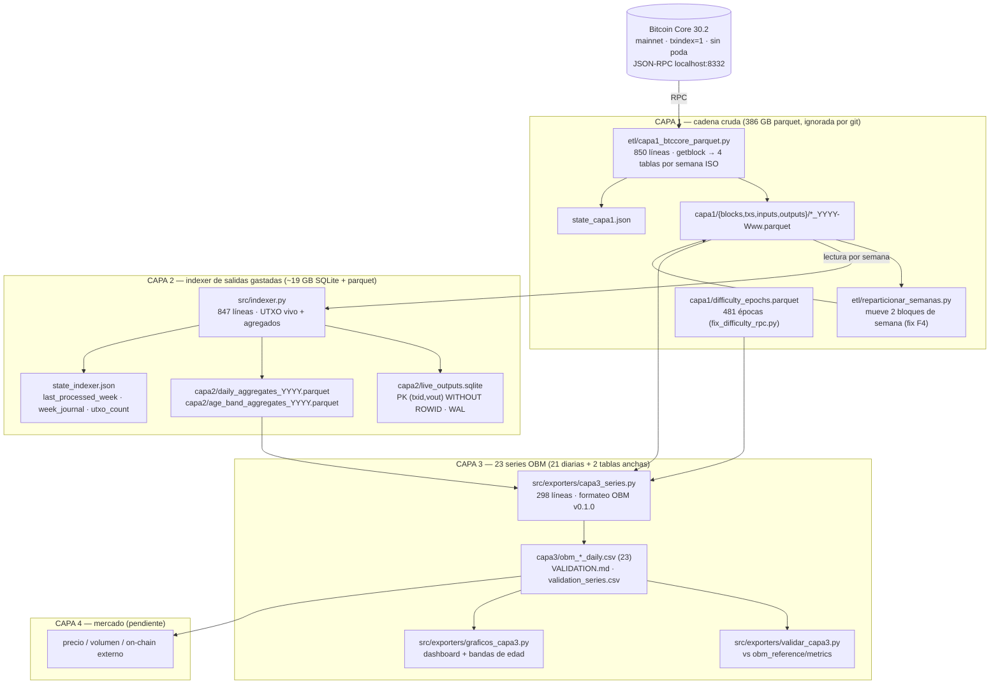

# Mapa de código — Réplica OBM v0.1.0 en 4 capas

Documento de orientación para agentes (Qwen Code y similares). Equivale al grafo que
generaría *graphify*: quién llama a quién, qué escribe cada módulo y qué invariantes
no se pueden romper. Los detalles de estado y reglas están en `QWEN.md`; los hallazgos
medidos en `AUDITORIA_HALLAZGOS.md`.

## 1. Panorama por capas



## 2. Orden de ejecución (reproducible desde cero)

```bash
python3 etl/capa1_btccore_parquet.py          # capa1  (node encendido, semanas ISO)
python3 etl/reparticionar_semanas.py          # fix F4: 2 bloques fuera de su semana
python3 src/indexer.py                        # capa2  (no necesita el nodo)
python3 src/exporters/capa3_series.py         # capa3  (23 CSV)
python3 src/exporters/validar_capa3.py        # validación vs OBM de referencia
python3 src/exporters/graficos_capa3.py       # figuras (opcional)
```

Scripts de una sola vez (ya ejecutados, se conservan como evidencia):
`src/exporters/fix_difficulty_rpc.py`, `src/exporters/reparar_wrap_2017.py`,
`src/exporters/reparar_semana_2022W06.py`, `src/exporters/reparar_utxo_eod_w06.py`,
`src/exporters/migrar_agregados_a_db.py`, `src/exporters/verificar_f7_autocuracion.py` y
`src/exporters/manifiesto.py`. Los `.bak_*` que crean son **temporales**: se borran tras verificar
(convención del repo; `.gitignore` los excluye).

## 3. Módulos

| Módulo | Rol | Entrada | Salida | Estado |
|---|---|---|---|---|
| `etl/capa1_btccore_parquet.py` | ETL capa1: 1 semana ISO por archivo, 4 tablas | RPC `getblock` | `capa1/**/*_YYYY-Www.parquet` | completo (970.447 bloques) |
| `etl/reparticionar_semanas.py` | Mueve bloques 60788 y 293303 a su semana por timestamp | capa1 | capa1 reescrito | aplicado |
| `src/bitcoin_math.py` | `bits_to_target`, `bits_to_difficulty`, `target_to_bits`, `difficulty_core` | bits hex | float/int | estable |
| `src/indexer.py` | capa2: gasta UTXOs, agrega por día UTC y banda de edad | capa1 | SQLite + parquet anual + state | completa (927 semanas) |
| `src/exporters/reparar_wrap_2017.py` | Arregla el wrap de 32 bits en 2017-W13 (2³²) | state/parquet | parquet corregido | aplicado |
| `src/exporters/capa3_series.py` | Construye las 23 series OBM con formato exacto | capa1 + capa2 | `capa3/*.csv` | completo |
| `src/exporters/validar_capa3.py` | Diff serie a serie vs OBM (tolerancia derivada de la referencia) + figuras | capa3 + referencia | `VALIDATION.md`, `figuras/` | completo |
| `src/exporters/manifiesto.py` | SHA-256 de los bytes validados y de la referencia | capa3 + `obm_reference/` | `capa3/MANIFEST.sha256` | completo |
| `src/exporters/migrar_agregados_a_db.py` | Rellena `daily_agg`/`age_band_agg` desde los parquet anuales (una vez) | capa2 parquet | DB + parquet reconstruido | aplicado |
| `src/exporters/verificar_f7_autocuracion.py` | Test negativo de la autocuración de F7 (entorno aislado) | — | stdout (5 pasos) | test |
| `src/exporters/fix_difficulty_rpc.py` | Extrae las épocas de dificultad desde el nodo (482: 0..481) | RPC | `capa1/difficulty_epochs.parquet` | aplicado |
| `src/exporters/reparar_semana_2022W06.py` | Recomputa 2022-W06 desde capa1 (ventana de crash F7) | capa1 | parquet 2022 | aplicado |
| `src/exporters/reparar_utxo_eod_w06.py` | Corrige `utxo_eod_count` de 2022-W06 (incluye coinbase) sin re-escanear | capa1 semana | parquet 2022 | aplicado |
| `src/exporters/graficos_capa3.py` | Figuras de presentación (dashboard + bandas) | capa3 | `capa3/figures/*.png` | utilitario |

## 4. Invariantes que no se tocan

1. **Nunca** `reset` de capa2: solo reprocesar semanas hacia adelante (`state_indexer.json`).
2. **Semanas monotonías**: capa1 se particiona por semana ISO del timestamp, y el indexer
   recorre en orden de altura. Un bloque fuera de su semana rompe el join de prevouts (F4).
3. **Sin `sqlite3_total_changes()`**: se trunca a 32 bits. Usar `cursor.rowcount` (F7).
4. **CDD nunca se trunca por input**: entero + resto/86400 (`cdd_rem_86400`) → 12 decimales.
5. **La cobertura parquet se verifica al arrancar** (`check_parquet_cobertura`, guard F7):
   si `weeks_done` dice que una semana está hecha y sus días no están en el parquet, aborta.
6. **Fusión anual = SUMA** de flujos (no `keep="last"`): una fecha puede estar repartida
   entre dos archivos semanales (F6). `utxo_eod_count` = último, `last_height` = máx.
7. **Protocolo (dificultad) se lee del nodo**, no se recalcula en coma flotante.
8. `logs/evidencia/` es evidencia de auditoría: no se borra ni se regenera.

## 5. Dónde mirar cuando algo no cuadra

| Síntoma | Primer sitio |
|---|---|
| Falta un día / un día en cero | parquet anual de capa2 vs `week_journal` (guard F7) |
| `utxo_eod_count` desviado en +1/+2 | BIP30 histórico 2010-11-14/15 (esperado, ver AUDITORIA) |
| Salto de 2³² en conteos | wrap de 2017-W13 (ya reparado) |
| CDD con error ~1e-11 | redondeo float de OBM; con `cdd_rem_86400` es residual |
| Dificultad difiere en el último ULP | usar `capa1/difficulty_epochs.parquet`, no fórmula cerrada |
| Semana lentísima (~1,5 h) | normal en 2023+: WAL grande + 10 M de inputs/semana |
