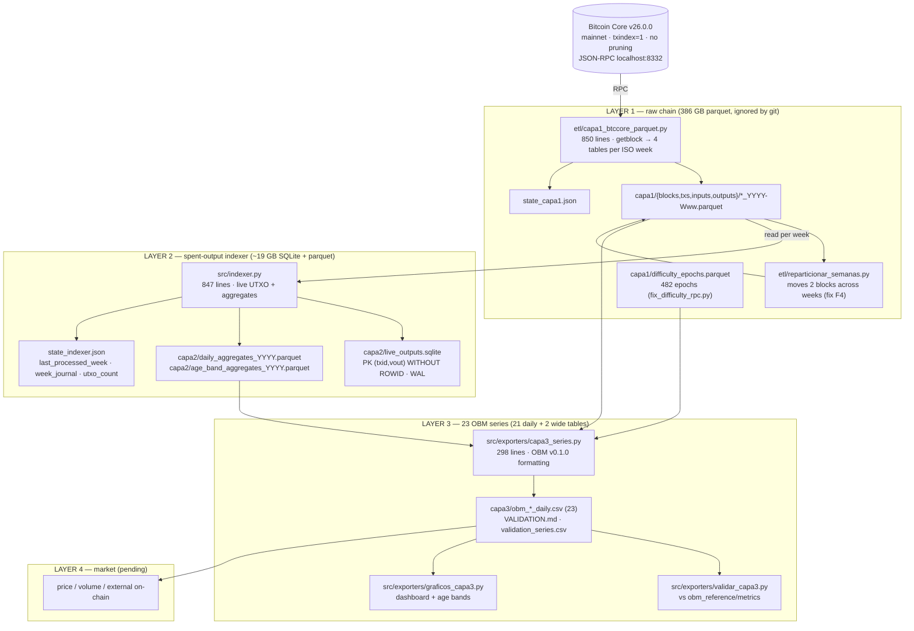

# Code map — OBM v0.1.0 replica in 4 layers

Orientation document for agents (Qwen Code and similar). It is equivalent to the graph that
*graphify* would generate: who calls whom, what each module writes and which invariants
cannot be broken. The status and rules details are in `QWEN.md`; the measured findings
in `AUDITORIA_HALLAZGOS.md`.

## 1. Layer overview



## 2. Execution order (reproducible from scratch)

```bash
python3 etl/capa1_btccore_parquet.py          # layer 1  (node running, ISO weeks)
python3 etl/reparticionar_semanas.py          # fix F4: 2 blocks outside their week
python3 src/indexer.py                        # layer 2  (does not need the node)
python3 src/exporters/capa3_series.py         # layer 3  (23 CSV)
python3 src/exporters/validar_capa3.py        # validation vs the reference OBM
python3 src/exporters/graficos_capa3.py       # figures (optional)
```

One-off scripts (already run, kept as evidence):
`src/exporters/fix_difficulty_rpc.py`, `src/exporters/reparar_wrap_2017.py`,
`src/exporters/reparar_semana_2022W06.py`, `src/exporters/reparar_utxo_eod_w06.py`,
`src/exporters/migrar_agregados_a_db.py`, `src/exporters/verificar_f7_autocuracion.py` and
`src/exporters/manifiesto.py`. The `.bak_*` files they create are **temporary**: they are deleted after verifying
(repo convention; `.gitignore` excludes them).

## 3. Modules

| Module | Role | Input | Output | Status |
|---|---|---|---|---|
| `etl/capa1_btccore_parquet.py` | Layer 1 ETL: 1 ISO week per file, 4 tables | RPC `getblock` | `capa1/**/*_YYYY-Www.parquet` | complete (970,447 blocks) |
| `etl/reparticionar_semanas.py` | Moves blocks 60788 and 293303 to their timestamp week | layer 1 | layer 1 rewritten | applied |
| `src/bitcoin_math.py` | `bits_to_target`, `bits_to_difficulty`, `target_to_bits`, `difficulty_core` | bits hex | float/int | stable |
| `src/indexer.py` | layer 2: spends UTXOs, aggregates by UTC day and age band | layer 1 | SQLite + yearly parquet + state | complete (927 weeks) |
| `src/exporters/reparar_wrap_2017.py` | Fixes the 32-bit wrap in 2017-W13 (2³²) | state/parquet | corrected parquet | applied |
| `src/exporters/capa3_series.py` | Builds the 23 OBM series with exact formatting | layer 1 + layer 2 | `capa3/*.csv` | complete |
| `src/exporters/validar_capa3.py` | Series-by-series diff vs OBM (tolerance derived from the reference) + figures | layer 3 + reference | `VALIDATION.md`, `figuras/` | complete |
| `src/exporters/manifiesto.py` | SHA-256 of the validated bytes and of the reference | layer 3 + `obm_reference/` | `capa3/MANIFEST.sha256` | complete |
| `src/exporters/migrar_agregados_a_db.py` | Fills `daily_agg`/`age_band_agg` from the yearly parquet files (once) | layer 2 parquet | DB + rebuilt parquet | applied |
| `src/exporters/verificar_f7_autocuracion.py` | Negative test of the F7 self-healing (isolated environment) | — | stdout (5 steps) | test |
| `src/exporters/fix_difficulty_rpc.py` | Extracts the difficulty epochs from the node (482: 0..481) | RPC | `capa1/difficulty_epochs.parquet` | applied |
| `src/exporters/reparar_semana_2022W06.py` | Recomputes 2022-W06 from layer 1 (F7 crash window) | layer 1 | parquet 2022 | applied |
| `src/exporters/reparar_utxo_eod_w06.py` | Fixes the `utxo_eod_count` of 2022-W06 (includes coinbase) without re-scanning | layer 1 week | parquet 2022 | applied |
| `src/exporters/graficos_capa3.py` | Presentation figures (dashboard + bands) | layer 3 | `capa3/figures/*.png` | utility |

## 4. Invariants that must not be touched

1. **Never** `reset` layer 2: only reprocess weeks forward (`state_indexer.json`).
2. **Week monotonicity**: layer 1 is partitioned by the ISO week of the timestamp, and the indexer
   walks in height order. A block outside its week breaks the prevout join (F4).
3. **No `sqlite3_total_changes()`**: it truncates at 32 bits. Use `cursor.rowcount` (F7).
4. **CDD is never truncated per input**: integer + remainder/86400 (`cdd_rem_86400`) → 12 decimals.
5. **Parquet coverage is verified on startup** (`check_parquet_cobertura`, F7 guard):
   if `weeks_done` says that a week is done and its days are not in the parquet, it aborts.
6. **Yearly merge = SUM** of flows (not `keep="last"`): a date can be split
   between two weekly files (F6). `utxo_eod_count` = last, `last_height` = max.
7. **The protocol (difficulty) is read from the node**, it is not recomputed in floating point.
8. `logs/evidencia/` is audit evidence: it is neither deleted nor regenerated.

## 5. Where to look when something does not add up

| Symptom | First place to look |
|---|---|
| A day is missing / a day at zero | layer 2 yearly parquet vs `week_journal` (F7 guard) |
| `utxo_eod_count` off by +1/+2 | historical BIP30 2010-11-14/15 (expected, see AUDITORIA) |
| Jump of 2³² in counts | 2017-W13 wrap (already repaired) |
| CDD with a ~1e-11 error | OBM float rounding; with `cdd_rem_86400` it is residual |
| Difficulty differs in the last ULP | use `capa1/difficulty_epochs.parquet`, not the closed formula |
| Very slow week (~1.5 h) | normal in 2023+: large WAL + 10 M inputs/week |
